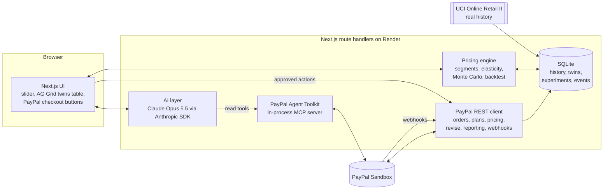

# saka: build plan

**saka** is a pricing copilot for small online sellers. Its product name in the demo is **PriceTwin**:
test a price change on AI copies of your real customers, built from your PayPal sales, then let
PayPal safely test it on a slice of real checkouts before you roll it out.

> Hackathon: [PayPal AI Hackathon](https://paypalaihackathon.devpost.com/) on Devpost.
> Hard requirement: meaningfully use the PayPal developer platform (sandbox) **and** an AI model.

---

## 1. Deadline and timeline

| Milestone | Pacific Time | India Time |
|---|---|---|
| Submissions close | Thu 12 Nov 2026, 12:00 PM | Fri 13 Nov 2026, 1:30 AM |
| Our internal submit target | Thu 12 Nov, 5:30 AM | Thu 12 Nov, 6:00 PM |
| Video uploaded to YouTube | Wed 11 Nov, 11:30 PM | Thu 12 Nov, 12:00 PM |
| Winners announced | Mon 21 Dec 2026 | Tue 22 Dec 2026 |

After the deadline: **no commits, README edits or video changes** until winners are announced.
Keep the hosted demo, sandbox app and API keys alive until 21 December.

---

## 2. The product in one minute

**Who:** small online sellers and subscription creators who sell through PayPal.
**Pain:** they set prices by guessing. Raise too much and loyal customers leave; never raise and costs eat the margin.

**Flow**
1. **Learn.** Connect PayPal. saka reads sales, fees, buyer countries and subscriptions and builds
   customer segments ("twins"): regulars, bulk buyers, occasional buyers, new customers.
2. **Be honest about uncertainty.** It shows how much history can and cannot tell: a forecast range
   that is wide when past price changes were few or noisy.
3. **Ask "what if".** A price slider shows the forecast: units, revenue, profit after PayPal fees,
   an 80% range, which segment is most at risk, and plain-English reactions from each segment.
4. **Test on real checkouts (price canary).** One in N new PayPal checkouts sees the new price.
   PayPal webhooks stream results back; a Bayesian update narrows the forecast range with every purchase,
   and saka stops automatically if the new price is losing. **This is the trust moment: PayPal turns a guess into evidence.**
5. **Apply with PayPal-native levers.** New price for new customers only, an intro offer using a priced
   trial cycle, a consent-first plan switch for existing subscribers, or a plan-wide price update.
6. **Protect.** Cancellations, refunds and disputes after launch feed a health check with one-click rollback.

**Demo hero:** a small UK gift shop. History is **real**: the UCI Online Retail II dataset
(802,634 clean purchase lines, Dec 2009 to Dec 2011). It shows genuine list-price changes, for example
the jumbo bag family moving from £1.95 to £2.08 in April 2011. Research showed those past changes are
too noisy to measure customers' price sensitivity reliably (see section 13), which is exactly why
saka tests on real PayPal checkouts before rolling out.

---

## 3. Scope

**Must have (submission)**
- [ ] Import real history (UCI, CC BY 4.0) and pull live PayPal sandbox data.
- [ ] Segment customers and fit price sensitivity per product and segment, with uncertainty.
- [ ] History check: past price changes with their measured effects and how noisy they are.
- [ ] What-if slider with revenue, profit after PayPal fees, range, segment risk.
- [ ] Claude-written segment reactions and a recommended lever, grounded in the model's numbers.
- [ ] Price canary on real sandbox checkouts with webhooks and an automatic stop rule.
- [ ] Apply: new plan for new customers, intro offer (trial cycle), consent-first switch link.
- [ ] Every write to PayPal behind an explicit **Approve** button; AI reads PayPal via the Agent Toolkit.
- [ ] Hosted on Render, public repo with MIT license, README, demo video under 3 minutes.

**Stretch**
- [ ] Regional pricing by payer country and currency.
- [ ] Pay Later messaging as a pricing lever for items in the Pay in 4 range.
- [ ] Win-back offer when a subscriber cancels over price.
- [ ] Post-launch health check with rollback.

**Out of scope:** production PayPal, real customer data beyond the public dataset, multi-tenant auth.

---

## 4. Architecture



**Stack:** Next.js 16 (App Router, TypeScript), Tailwind, AG Grid, Node built-in SQLite,
`@anthropic-ai/sdk`, `@paypal/agent-toolkit` (MCP export) with `@modelcontextprotocol/sdk`, Vitest, Render.

**Folders**
```
src/app/                UI pages and API route handlers
src/lib/engine/         segmentation, elasticity, forecast, backtest (pure, unit-tested)
src/lib/paypal/         REST client, webhooks, Agent Toolkit bridge
src/lib/ai/             Claude prompts and structured outputs
src/lib/db/             SQLite schema and queries
scripts/                data import, sandbox seeding
data/uci/               processed real history (committed, CC BY 4.0)
```

---

## 5. Pricing engine (the sophisticated part)

1. **Weekly demand series** per product: units, orders, customers, and the list price that week (modal unit price).
2. **Price-change detection:** step changes in the weekly list price that persist for at least 8 weeks.
3. **Segments** from behaviour, with simple explainable rules: regulars (frequent, recent), bulk buyers
   (large quantity per line), occasional, new. Each segment is a "twin" group shown in the table.
4. **Price sensitivity (elasticity):** log-log regression of weekly units on list price with month-of-year
   effects and a trend. **Bayesian shrinkage** toward a typical value when a product has little price variation,
   so the model admits uncertainty instead of inventing precision.
5. **Forecast:** Monte Carlo draws from the elasticity posterior give the median and 80% range for units,
   revenue and **profit after PayPal fees** (fees read from real PayPal transactions when available).
6. **History check:** group same-day price changes into events and measure each one with difference-in-differences
   against products whose price did not move. Shows the seller how much (or how little) their history proves.
7. **Bayesian price canary:** the history-based elasticity is the prior; offer views and PayPal-captured purchases
   for the control and test prices are the data. Importance-weighted draws give the posterior elasticity, the
   profit-per-visitor change with a range, and the probability the new price wins. Stop for harm below 5%,
   ready to roll out above 95%, after a minimum number of views per price.

The statistics produce the numbers. Claude explains them, voices each segment and proposes levers.
This answers the known weakness of pure AI "synthetic customers": they are not anchored to real buying data.

---

## 6. AI layer

- **Model:** Claude Opus 5.5 (`claude-opus-5-5`) through the official Anthropic TypeScript SDK, adaptive thinking,
  structured outputs with Zod, server-side refusal fallbacks enabled.
- **Segment reactions:** for each segment, short first-person reactions consistent with the model's predicted
  retention, plus the reasons. Numbers are passed in; Claude never invents them.
- **Pricing advisor:** reads PayPal data through the **PayPal Agent Toolkit** (read-only tools such as
  `list_transactions`, `get_merchant_insights`, `list_subscription_plans`), then proposes one or more actions
  (canary, intro offer, grandfathering, plan update) as structured proposals.
- **Human in the loop:** proposals are shown as cards. Nothing is written to PayPal until the seller clicks Approve.

---

## 7. PayPal integration map

| Stage | What PayPal does | API |
|---|---|---|
| Learn | Sales, fees, payer country, refunds | Agent Toolkit `list_transactions` / `GET /v1/reporting/transactions` (31-day windows, up to 3 years) |
| Learn | Shop-level insight | Agent Toolkit `get_merchant_insights` |
| Learn | Plans and subscribers | `list_subscription_plans`, `GET /v1/billing/subscriptions/{id}`, `/transactions` |
| Test | Canary price on real checkouts | JS SDK buttons + `POST /v2/checkout/orders`, `/capture` |
| Test | Subscription canary | Two plans side by side: `POST /v1/billing/plans` |
| Test | Live results | Webhooks `CHECKOUT.ORDER.APPROVED`, `PAYMENT.CAPTURE.COMPLETED`, `BILLING.SUBSCRIPTION.ACTIVATED`, `BILLING.SUBSCRIPTION.CANCELLED` |
| Apply | New price for new customers | `POST /v1/catalogs/products`, `POST /v1/billing/plans` |
| Apply | Intro offer | Plan with up to two priced `TRIAL` billing cycles |
| Apply | Consent-first switch | `POST /v1/billing/subscriptions/{id}/revise` returns an approval link |
| Apply | Plan-wide price (optional) | `POST /v1/billing/plans/{id}/update-pricing-schemes`, currently rejected in our sandbox, see section 13 |
| Protect | Refunds and disputes | Webhooks `PAYMENT.CAPTURE.REFUNDED`, `CUSTOMER.DISPUTE.CREATED`; toolkit `list_disputes` |
| All | Security | `POST /v1/notifications/verify-webhook-signature`; `PayPal-Request-Id` idempotency on writes |

---

## 8. Owner setup checklist (needs your accounts)

1. **PayPal developer dashboard** (sandbox): create an app, copy Client ID and Secret.
2. Sandbox **business** account (merchant) and **personal** account (buyer) exist under Testing Tools.
3. On the app, enable **Transaction search**, **Subscriptions**, **Invoicing**, and **Advanced card payments**
   if offered (lets scripts run test-card checkouts without a buyer popup).
4. Add a webhook pointing to `https://<render-url>/api/paypal/webhook` with the events in section 7; copy the Webhook ID.
5. **Anthropic API key** for Claude.
6. **Render** account: create a Web Service from the GitHub repo (Node), add the env vars from `.env.example`.

---

## 9. Build schedule

**Day 1, Tue 10 Nov (India evening)**
- [x] Repo, plan, scaffold, dependencies.
- [x] Import real history; verify price changes exist (done: Jumbo Bag jumbo bag family £1.95 to £2.08 on 2011-04-04).
- [x] Engine: weekly series, change detection, segments, elasticity with shrinkage, Monte Carlo, difference-in-differences, Bayesian canary, 10 unit tests.
- [x] PayPal REST client (orders, products, plans, intro offers, price update, revise, reporting, webhook verification).
- [x] Agent Toolkit bridge: in-process MCP server exposing 10 read-only PayPal tools to Claude (verified).
- [x] Claude layer: segment voices (structured output) and advisor loop with proposals (needs API key to run live).
- [ ] Sandbox seeding script and first live calls (needs your PayPal sandbox keys).

**Day 2, Wed 11 Nov**
- [ ] UI: shop overview, history check, what-if slider, AG Grid twins table.
- [ ] Claude segment reactions and advisor proposals.
- [ ] Canary: checkout buttons with assigned price, webhooks, stop rule.
- [ ] Apply: new plan, intro offer, consent-first switch link.
- [ ] Deploy to Render; end-to-end run in sandbox.
- [ ] Record and upload the video by midnight India time.

**Day 3, Thu 12 Nov (until 6 PM India)**
- [ ] Polish, README screenshots, fill the Devpost form, submit early, then refine until the deadline.

---

## 10. Demo video (under 3 minutes)

| Time | Scene |
|---|---|
| 0:00 | Maya runs a small gift shop on PayPal. Costs rose; she is scared to raise prices. |
| 0:20 | saka connects to PayPal and builds customer twins from her real sales history. |
| 0:40 | Honest range: history says profit could move anywhere from a loss to a gain; here is why. |
| 1:05 | What-if slider: profit after PayPal fees, range, the segment at risk, segment voices. |
| 1:35 | Claude suggests a gentler move; she approves a price canary. |
| 1:55 | Real PayPal checkouts at the test price; webhooks arrive; the range visibly narrows; the stop rule decides. |
| 2:20 | Apply: new plan for new customers, intro offer, consent link for a loyal subscriber. |
| 2:45 | PayPal sandbox dashboard shows the new plan. Close on the impact line. |

---

## 11. Devpost submission checklist

- [ ] Public GitHub repo with MIT license visible in the About section.
- [ ] README: setup, how PayPal and AI are used, sponsor tools, dataset attribution.
- [ ] Hosted demo URL (Render) and test instructions; no secrets in the repo.
- [ ] YouTube video, public, under 3 minutes.
- [ ] Form: submitter type, country, "New" project, technology explanation naming each PayPal and AI tool,
      sponsor tools (AG Grid, Render), repo URL, demo URL, feedback answers.

---

## 12. Risks and mitigations

| Risk | Mitigation |
|---|---|
| Sandbox payments are dated today, so no history inside PayPal | Real history comes from the UCI import; PayPal provides live data from now on |
| Transaction search can lag about three hours in sandbox | Seed sandbox sales on Day 1 morning; cache results |
| Wallet and subscription checkouts need a buyer to approve | Do a few live approvals on video; script volume with sandbox test cards |
| AI reactions may contradict the numbers | Numbers are inputs; structured output ties each reaction to a predicted retention |
| Elasticity is noisy for products with little price variation | Bayesian shrinkage plus visible ranges; backtest on a product that really changed |
| Time | Must-have list first; stretch only after the video is uploaded |
| History cannot prove price sensitivity for this shop | Present it honestly as a wide prior; the PayPal canary supplies the evidence |

---

## 13. Research log

**10 Nov 2026: can history prove price sensitivity? No.**
- 20 persistent list-price changes were found in the 60 best-selling products (`scripts/research/`).
- A single-product demand model put the real outcome inside its 80% range for only 4 of 20 changes.
- Difference-in-differences against unchanged products gave effects from a 72% drop to a 218% rise for similar
  small increases, and the sign often flipped when the window changed from 6 to 12 weeks.
- Counting retail-sized orders instead of units reduced, but did not remove, the noise.
- Conclusion: a "replay the past price rise" demo would mislead. saka shows history as a wide, honest prior and
  uses the PayPal price canary as the evidence that narrows it.

**10 Nov 2026: live sandbox smoke test (`scripts/smoke-live.ts`).**
- Working: OAuth, Orders v2 (GBP), Catalog products, plans with a priced trial cycle, Transaction search,
  Agent Toolkit over in-process MCP (`list_subscription_plans`, `list_transactions` return real sandbox data).
- `update-pricing-schemes` returns 422 `PRICING_SCHEME_UPDATE_NOT_ALLOWED` for every plan we tried, with or
  without a trial cycle. Others report the same sandbox error with no published fix. saka therefore applies
  new prices through a new plan for new customers and a consent-first `revise` for existing subscribers.
